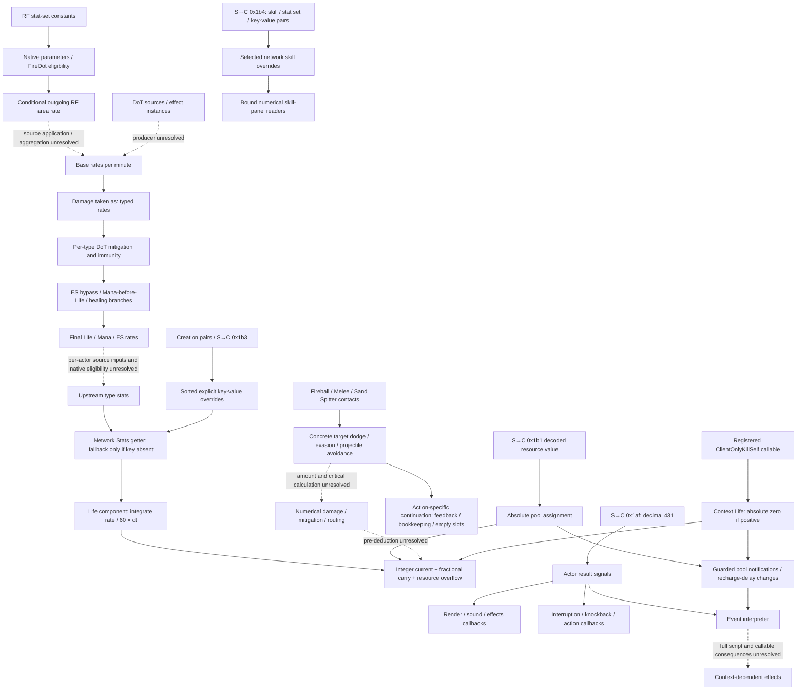

# Client damage calculation and resource prediction (3.29.3b)

## 1. Question, scope and evidence rules

Does the client calculate damage, change its local resources, and later accept a server correction?
Treat those as three separate questions, for both **hits** and **damage over time**.
"Pre-resolution" is a research name, not an established description of every client combat path.
The goal is to recover useful calculations and their execution boundaries before choosing a server implementation.

The strongest result so far is **continuous resource integration plus incoming absolute pool assignment**.
Typed DoT formula chains are present, including mitigation, healing exclusions and Life/Mana/ES routing.
Their presence alone does not prove that an ordinary network entity evaluates those whole chains.
Network Stats can supply a final rate directly and bypass upstream calculation for that key.
Ordinary network Actor/skill provider identities, update forwarding and lookup freshness are now established.
The successful startup path disables the separate action-local native stat mutation mechanism.
Concrete Fireball contact/avoidance and Melee accuracy/entropy decisions are now bound locally.
The connection from those decisions to numerical damage/mitigation/pre-deduction has **not** been established.

| Evidence class | Meaning here |
|---|---|
| Static artifact | Original PE bytes, decoded instructions, installed tables and conditional call/data flow |
| Analyst inference | A proposed meaning or path whose object binding or caller is still unresolved |
| Historical local runtime | Previously recorded behavior of this client connected to LocalExile |
| Official-server behavior | Requires separate evidence; neither the executable nor a local-server trace proves it |

The work in this page is static analysis.
No client was started, attached, hooked, controlled or played for this investigation.
Older runtime results are identified explicitly and remain in [recovery timing](recovery-timing.md).
Addresses below are preferred-image virtual addresses, not live ASLR addresses.
Decompiler signatures and guessed names are not original source.

### Artifact identity and reproducibility

| Input | Identity |
|---|---|
| Executable | `Client/Game.exe`, PE x86-64, client 3.29.3b |
| Preferred image base | `0x140000000` |
| Executable SHA256 | `78a0e227189c263658a7f65a02f086428b859bfc114ae8e7ce8aab721ebd48d5` |
| `data/tables/Stats.json` SHA256 | `91c2ed42f6d8094a2704f56aea32f6f16243881b04aadbe4fdbbdd3a566f05da` |
| Stats mapping | Native/wire key `k` is zero-based JSON row `k - 1`, field `Id`; 23,346 rows |
| Offline decoders | Capstone 5.0.3, pefile 2024.8.26 |
| Selected decompilation | Ghidra 12.1.4, JDK 21.0.12.1, `-noanalysis`, selected function bodies only |

The [evidence manifest](client-damage-evidence.json) retains function ranges, original-file offsets and SHA256s.
It contains analysis metadata, not copied executable bytes or a full decompiler dump.
Its `boundary` distinguishes unwind-owned functions, explicit leaf ranges and four historical bounded thunk entries.
`selectedDecompilationCompleted: null` means no selected decompilation was retained, not a decompiler failure.
Reproduce the original-byte audit with [damage_audit.py](../../../scripts/re/damage_audit.py).
See [tooling](tooling.md#bounded-damage-audit) for invocation and selected Ghidra decompilation.
Local generated `audit.json`, `.asm` and `decompilations.jsonl` stay under ignored `Tools/re/out/`.
They are offline evidence records, not REA Evidence IDs.

Detailed supplements keep the evidence reviewable without treating this summary as an exhaustive formula list:

- [Stat objects, inputs, notifications and startup guards](client-stat-evaluation.md).
- [Typed DoT formulas, resource routes and arithmetic boundaries](client-dot-routing.md).
- [Both-hand offence formulas, conversion, average/DPS and numerical UI consumers](client-offence-estimates.md).
- [Concrete Fireball/Melee contact production, avoidance and entropy](client-hit-production.md).
- [Default ranged-action selector, weapon-state provider and registry candidates](client-ranged-action-selection.md).
- [Hit queues, action contexts and control effects](client-hit-feedback.md).
- [Hit/resource receiver search and its precise coverage](client-hit-resource-boundary.md).
- [Predictive/lockstep scheduling and resource correction](client-damage-timing.md).
- [Versioned official/community explanations and PoB comparisons](client-damage-comparisons.md).
- [Pinned PR #373 reports, independently checked fields and skill-stat updates](client-damage-pr373-comparison.md).

## 2. Observed graph and missing connections

Solid edges below represent verified local data/control dependencies.
Dashed edges are unresolved bindings, not an assumed end-to-end execution path.



The DoT formula graph and the network pool integration graph are both real static findings.
The upstream getter and separate formula publication mechanism are now identified below.
The ordinary network Actor/skill provider chain is bound separately in the stat-context supplement.
The dashed rate edge still requires source-effect inputs and eligibility on the relevant native object;
network getters can instead read an explicit received final rate.
It is incorrect to present this drawing as proof that the client simulates every source or hit independently.
The solid contact/avoidance branch has concrete action tables and actual target providers;
it is separate from both deterministic panel estimates and received hit feedback.
The RF formula branch is conditional native computation from recovered skill parameters.
It does not close the separate effect-instance/application edge into an enemy's incoming base rate.

## 3. Stats interfaces: explicit overrides and upstream calculations

### Network override provider

`0x1424cfa40` searches sorted eight-byte `(key, value)` pairs at provider `+0xf0..+0xf8`.
An exact match returns its value, **including an explicit zero**, at `0x1424cfaa5`.
Only an absent key falls back through the interface at `+0xe0`; a null upstream returns zero.
The fallback is a virtual getter tail jump at `0x1424cfabc`.
This is an override lookup, not addition of a server value to a locally computed value.

`0x1424cfaf0` replaces an existing pair or inserts a new sorted pair.
It dispatches the changed key through `0x1424cfd00`.
That notification is not proof of complete transitive invalidation of every derived-stat cache.
Creation pairs (`0x1421c2f40`) and S→C `0x1b3` use this setter.
See [the wire format](../protocol/10-chat-and-commands.md#3-sc-0x1b3-stats-update).

The binding to real components is not just a table guessed from a pointer occurrence:

1. `0x1421c2ad0` installs the ClientInternalStats component table `0x1435dd4e8`.
2. It constructs a shared wrapper through `0x1421c3700` and stores the wrapper at component `+0x20`.
3. The wrapper installs table `0x14363bd90`, whose getter slot is `0x1424cfa40`.
4. The wrapper's `+0xe0` upstream comes from the type object's shared pointer at `+0x10`.
5. This constructor supplies flag `1`, skipping the optional upstream subscription block.
6. The Life constructor binds its Stats component at `Life+0x168`.
   Pool steps load `pool+8 → Life+0x168 → Stats+0x20` and call that interface's getter.

### Type fallback and separate update/evaluation transaction

The type binding is now resolved beyond the shared-pointer field:

```text
ClientInternalStats type factory 0x142182790
  → base type constructor 0x141e40560
  → shared stats constructor helper 0x141e496c0 at type+0x10
  → native stat object constructor 0x1424fb790
  → installed getter table 0x14363d3b0, slot 0 = 0x1424fc1e0
```

Consequently a missing network override reads the type stat object's stored records.
The getter itself does not dispatch a formula.
However, it would also be incorrect to conclude that these records can never contain computed values.
A separate update transaction can evaluate formulas and publish their results into those same records:

- `0x1424fd240` begins/nests an update and creates an evaluation context at object `+0x190` when needed.
- `0x1424fc480` adds a source contribution to a stat record and tracks affected values.
  The type's `set_...` parser, `0x141e406e0`, uses it.
- `0x1424fd390` ends an update; at the outermost boundary it processes the affected evaluation entries.
  One dispatch call is `0x1424fd4c3 → 0x1424fcc80`.
- `0x142513630` registers the callback at registry `0x1445c6ec8 + key * 0x50`.
  It also records dependencies and their reverse edges.
- `0x1424fcc80` checks the entry's eligibility, calls the registered function at `0x1424fccf8`,
  updates the evaluation cache and writes changed output into record `+8` at `0x1424fcdb3`.
  It also queues notifications/affected values through `0x1424fcec0` and related helpers.

This closes **registration → transaction dispatch → result publication → getter** as a conditional static mechanism.
The constructor `0x141e40560` itself brackets type initialization with `0x1424fd240`/`0x1424fd390`.
The ordinary network Actor/skill provider chain and its actual update contract are now closed in
[stat evaluation](client-stat-evaluation.md).
Network skills inherit the owner's network wrapper, with explicit per-skill pairs and additional-set wrappers.
The getter reads current pairs/current upstream, while notifications mask overridden keys and forward inherited changes.
The audited setter/forwarder/dispatcher does not enter a native dependency transaction.
Successful client startup sets `0x1445b38cd` to one; action-local native context mutation is skipped under that guard.
Native formula eligibility and source-effect instance production remain separate from this network lookup contract.
Network wrapper setters and native contribution setters are different paths and different objects.
The audited network setter stores its pairs and notifies its listeners; it does not directly enter this transaction.
Do not infer that sending one raw network input automatically makes every omitted derived output recompute.

### Separate raw-stat and derived-stat machinery

The formula callbacks use the native storage and evaluation layout rather than the network pair vector.
`0x1424fc1e0` checks valid keys `1..0x5b32`, a presence bitmap at `+0x268`, and sorted 40-byte records at `+0x1f0`.
The raw value is at record `+8`; its parent is at object `+0xf0`.
Do not confuse this parent pointer with the network wrapper's vector at the same offset.

The callbacks also use cached values and validity bits in an evaluation context.
`0x142513630` is a registration entry point; the selected registration functions bind a stat key to a callback.
For example `0x1400ac590` binds key 2022 to `0x1426cce60`, and `0x1400ad7c0` binds key 3356 to `0x1426da000`.
The transaction dispatcher provides an actual conditional callback invocation, beyond registration alone.
Specific actor/skill inputs and transaction guards still determine which outputs are evaluated and when.

## 4. DoT: raw rates, taken-as and mitigation

### Rate units and input boundary

These stats express a **rate in damage points per minute**.
The Life pool code turns a rate into an increment with `rate / 60 * dt`.
There is no observed elapsed-minute counter or minute-boundary reset in the audited path.
The word "minute" describes the numeric unit, not a rolling or resettable damage budget.

| Output key / Id | Callback | Verified input meaning |
|---|---|---|
| 2022 `fire_damage_taken_per_minute` | `0x1426cce60` | Forwards 2023 `base_fire_damage_taken_per_minute` |
| 1864 `physical_damage_taken_per_minute` | `0x1426cc060` | Base physical rate plus a per-talisman-stack contribution |
| 352 `chaos_damage_taken_per_minute` | `0x1426cf780` | Base chaos rate plus a per-viper-orb contribution |
| 9563 `total_base_damage_per_minute_taken_as_physical` | `0x1426d3820` | Typed taken-as inputs, before physical mitigation |
| 9564 `total_base_damage_per_minute_taken_as_fire` | `0x1426d40f0` | Remaining fire plus physical/cold/lightning/chaos taken as fire |
| 3355 `total_physical_damage_taken_per_minute` | `0x1426d9550` | Physical reduction, taken modifiers, immunity/prohibition |
| 3356 `total_fire_damage_taken_per_minute` | `0x1426da000` | Fire DoT resistance, reduction, taken modifiers, immunity/prohibition |

The forwarding callback for fire does not contain an ignite list, RF radius or a duration/snapshot model.
The producer of base rate 2023 is still unresolved.
Separately, an outgoing RF chain is now established: stat-set constants 883/1947/3399 feed
14408, then area-skill intermediate 8198 and final outgoing area rate 5981. It uses skill-user
Life/ES and mana providers, distinct modifier stages and rounding boundaries. Generic outgoing
fire rate 1999 has a different intermediate; no direct `14408 → 1999` edge was found in these bodies.
See [the outgoing RF formula bridge](client-dot-routing.md#outgoing-righteous-fire-formula-bridge).
These conditional native formulas do not establish a source-instance snapshot, nearby-target
application, or publication of the result into incoming rate 2023.
One investigated candidate, factory `0x1412c40e0`, passes immediate `0x7e7` (2023) through action constructors.
The base action constructor `0x141937cc0` stores it as a 16-bit value at action `+0x118`.
This is **not a verified stat setter**, even though the integer matches the fire stat key.
It must not be named an RF/base-fire-rate producer without further data flow.

### Fire DoT worked formula

The following is a readable algebraic summary of `0x1426da000`, not a bit-exact port.
Individual operations use binary32 arithmetic; the executable's rounding and cache boundaries also matter.

```text
I(x) = max(0, (100 + x) / 100)
K = (1 - fireDoTResistance / 100)
    * I(virtual_fire_damage_taken_over_time_+%)
    * I(fire_damage_taken_over_time_+%_final)
    * I(hellscape_monster_damage_taken_+%_final)

rate = K * (1 - additional_elemental_damage_reduction_% / 100)
       * (total_base_damage_per_minute_taken_as_fire * I(levelTakenModifier)
          + fireRateUnaffectedByLevelScaling)
```

The callback returns zero for `cannot_be_damaged` (19670), `cannot_take_damage_over_time` (15468),
or `fire_damage_immunity` (4522).
The paired stopped-taking-fire-DoT flags 19157/19158 also select the zero branch.
The two base inputs are keys 9564 and 9569; the level modifier is key 8173.
The `max(0, ...)` helper at `0x14013c620` was checked in original instructions.
`virtual_fire_damage_taken_over_time_+%` (10737), callback `0x1427d4bd0`, combines fire/DoT/burning taken increases.

The fire DoT resistance evaluator `0x14271a3f0` (17170) has concrete special branches:

- Key 18912, `no_fire_resistance_to_dot`, returns zero.
- Key 18064 returns zero while key 20408, `virtual_is_moving`, is false.
- Otherwise clamp uncapped fire DoT resistance 17171 to at least -200 and to the selected maximum.
- The maximum is key 146, or highest maximum elemental resistance 15619 when flag 15620 is active.

There is no additional hard-coded 90% clamp in this callback.
Whether its maximum input already includes that rule is a separate upstream question.
Hit penetration is not an input in this audited fire DoT callback.
That observation does not by itself establish all official-server DoT rules.

### Saturation is present at multiple stages

The taken-as-fire callback saturates its output before the fire mitigation callback runs.
The fire mitigation callback saturates again, and selected resource aggregates saturate again.
At `0x1426dab9d`, the fire callback returns `0x7fffffff` after comparing against binary32 `2^31`
from `0x1436a48a8`; smaller results use signed half-point adjustment and truncation, then nonnegative clamping.
The threshold constant is not the exactly represented integer `2^31 - 1`.
Do not silently replace native float edge behavior with ideal real-number arithmetic.

`(2^31 - 1) / 60 = 35,791,394.1166...` damage per second explains the familiar magnitude.
It does **not** prove one universal final `min(sum effective DPS, cap)` operation on the official server.
The audited client has intermediate caps, and some later aggregates use ordinary 32-bit additions.
For example the ES overflow ratio uses `lea eax,[rcx+rbx]` at `0x1426e787a` before signed conversion to float.
That operation is not a saturating or widened sum.
The valid range and reachability of overflow cases require further research.

## 5. DoT resource routing and local integration

`0x14281bd60` computes fire ES bypass (9609).
It returns 100 for key 9587 (`keystone_divine_flesh`) or 9586 (`keystone_miracle_of_thaumaturgy`).
Otherwise it clamps non-chaos bypass 9677 to 0..100.
The presence of those branches is verified; their full interaction with every resource is not yet established.

The typed routing chain distinguishes ES-bypassing damage, damage eligible for ES, Mana-before-Life and healing.
The next work item is to re-audit each route, rather than infer it from its stat name.
The audited aggregate functions already show separate resource totals:

| Key | Callback | Observed role |
|---|---|---|
| 9595 | `0x1426e53f0` | Sum of six Life-directed bypass channels, with float saturation |
| 3361 | `0x1426e7410` | ES rate; selection includes `virtual_energy_shield_protects_mana` (5338) |
| 3362 | `0x1426e7d60` | Life rate; complementary selection using 5338 |
| 3364 | `0x1426e7fc0` | Nonlethal Life aggregate; includes a plain integer addition |
| 9960 | `0x1426e7670` | ES overflow share to Mana, permyriad, from Life/Mana-directed ES channels |
| 9961 | `0x1426e7b00` | Corresponding nonlethal overflow ratio |

`0x141e6a190` steps Life, ES and Mana when its life/alive, world and spectating guards permit it.
The time argument is forwarded in floating-point registers even where Ghidra omits it from the signature.
The pool steps are `0x141e6ae70`, `0x141e6b480` and `0x141e6cba0`.
They read continuous loss/rate stats and multiply by the step duration; recovery uses `0x141e6b320`.
For ES, total damage 3361 and nonlethal damage 3363 are distinct from generic ES loss 12609.
The reason codes passed to the reducers also differ.
Do not merge spending, generic loss and damage solely because they all change a pool.

The common loss reducer `0x141e6a6b0` uses integer current at pool `+0x30` and fractional carry at `+0x28`.
It adds the signed delta to the fraction, truncates the whole part, updates current, and retains the remainder.
When the pool is depleted it returns unabsorbed negative remainder in **XMM0**.
The float return is established by the raw instructions; Ghidra's recovered `void` signature omits it.
Current and fractional writes are at `0x141e6a6f9` and `0x141e6a707`.

ES reducer `0x141e6a780` routes negative overflow for reason 1.
With 5338 active it goes to Mana; otherwise ratio 9960/9961 divides it between Mana and Life.
Mana reducer `0x141e6ae00` can spill its negative remainder to Life.
Life reducer `0x141e6a8a0` has cannot-die/nonlethal/reason-6 floor-one branches.
These are resource transitions, not proof that the client creates fresh hits on spill recipients.

The Life virtual slot `+0xe0`, `0x141e6a370`, reads spending rates 15045..15048.
It is **not** a discovered incoming-hit resolution function.

## 6. Incoming resource assignment and what "correction" means

S→C `0x1b1` reaches the world handler `0x142187480`.
Its Life/Mana/ES branches call `0x141e69fb0` at `0x1421880e6`, `0x1421880cb` and `0x1421880b7`.
The setter copies decoded message current at `+0x20` to pool `+0x30`, reserved at `+0x24` to pool `+0x10`,
and the percentage-reservation input at `+0x2a` to pool `+0x14`.
The current-value assignment is at `0x141e69fd1`.
Those message offsets are **decoded in-memory fields**, not raw packet offsets.
See [Life serialization](../protocol/04-player-entity.md#44-life-0x141e6c2f0-55-bytes).

The setter assigns a total rather than applying a damage delta.
It does not itself write fractional carry at `+0x28`, rewind a simulation or replay an input history.
The surrounding Life-only nonpositive-to-positive branch does clear that pool's carry at `0x142188129`;
this is distinct from an ordinary assignment.
Calling this an authoritative-value correction describes the assignment, not an established rollback algorithm.
No official-server correction cadence has been measured by this static work.
The setter also dispatches guarded change/full/empty/loss notifications; loss notification can update recharge
delay and enter the event system. See [assignment consequences](client-damage-timing.md#assignment-notifications-and-recharge-delay).

Historical LocalExile recovery probes observed native pool changes between server corrections.
Those traces support continuous resource extrapolation for the supplied rates.
They are not evidence of independent hit prediction or official-server formulas.
They also measured about 120 Life ticks/s in the foreground and about 10/s in the background.
A `0.033` constant in `0x1428548a0` is used in an ES threshold estimate, not proof of a 33 ms Life scheduler.
Keep client rendering/update time, protocol frame length and server logic cadence separate.

## 7. Hit investigation: established feedback, unresolved numerical prediction

Decimal 431 is S→C `0x1af`, not the Life-total packet `0x1b1`.
Its newly audited [reader and conditional fields](../protocol/29-client-combat-signals.md) have a separate protocol page.
The previously retained, same-SHA static callback audit establishes this conditional path:

```text
Actor dispatcher 0x1421940a0 / consumer 0x1421952a0
  → 0x141e90f50 → Actor virtual slot +0x230 (0x141e91580)
  → Actor source signals +0x2e8 / +0x368 and target signal +0x3e8
  → registered Render / sound / effect callbacks
```

Render constructor `0x1415f5d50` registers `0x141600c10`, `0x141600aa0` and `0x141609f40` on those signals.
The `+0x368` callback prepares `Audio/Sound Effects/WeaponSwinging/MissSG`.
This does not establish an exhaustive miss/block taxonomy or a numerical accuracy roll.
The confirmed receiver is Render, not Life.
No numerical pre-deduction edge from those audited feedback callbacks to a pool reducer has been established.
The historical callback audit is distinguished from the freshly decoded function ranges in the evidence manifest.

The wider result consumer also drives timed interruption, knockback and action callbacks, as detailed in
[Hit feedback](client-hit-feedback.md). Named Fireball and Melee registrations now bind their concrete
`+0x2d0/+0x2d8` targets; Melee has a nonempty test-effect callback in one registry mode.
Event `0x6876` reaches a 102-opcode interpreter with descriptor-selected native callables.
Those program/callable identities remain unresolved, so the whole result consumer cannot be classified as presentation only.
See [concrete action and event boundaries](client-hit-resource-boundary.md#7-concrete-action-callbacks-fireball-and-melee).

### Why a direct-call negative result is insufficient

A fresh executable-section E8/E9 scan of the four pool reducers finds continuous changes, overflow and spending.
It finds no independent direct-call hit calculation among those callers.
However, the reducers also occupy **virtual slot +0x48** in installed pool tables:

| Pool table | Slot +0x48 |
|---|---|
| `0x1435a5da0` | Life `0x141e6a8a0` |
| `0x1435a5b68` | Mana `0x141e6ae00` |
| `0x1435a6218` | ES `0x141e6a780` |

An additional instruction-boundary-checked FF /2 and /4 displacement scan found 667 candidate sites in 448 owners
for displacement `0x48`, plus 21 unowned candidate byte positions.
These are **generic indirect-call candidates**, not 667 calls to Life or proof of hit prediction.
Receiver provenance is required; most vtables are unrelated.
The scan excludes register-held targets, other prefix forms and unidentified leaf functions.
Selected candidates give concrete reasons not to identify every slot-`0x48` call as resource loss:

| Candidate owner | Observed receiver/data flow | Boundary |
|---|---|---|
| `0x141e8eb60` | Actor's current action at `+0x1b8`; boolean result controls action progression | Not a proved pool receiver |
| `0x141e35d30` | Service returned through world interface `+0x180`; passes owner and integer state | Not a proved pool receiver |
| `0x141eb5e10` / `0x141eb7ca0` / `0x141fd52f0` | Parse fields into the message object, then invoke its slot `+0x48` | Message continuation, not a proved pool receiver |

The global receiver analysis remains incomplete.
The result therefore is **unproven**, not "the client cannot calculate hits".

### Hit-related stat calculations are present

The freshly audited registrations bind the following outputs to native evaluators:

| Key / Id | Registration | Evaluator | Established calculation boundary |
|---|---|---|---|
| 670 `main_hand_minimum_total_damage` | `0x140096290` | `0x142543a80` | Adds the five typed minimum ranges |
| 279 `main_hand_minimum_physical_damage` | `0x1400982a0` | `0x1425733e0` | Base/added inputs, combined modifiers, conversion loss, integer output |
| 1563 `main_hand_total_minimum_base_physical_damage` | `0x1400995f0` | `0x142594860` | Weapon-local inputs including physical flat, local increase and quality |
| 1575 `main_hand_total_minimum_added_physical_damage` | `0x140099ed0` | `0x1425988a0` | Intermediate added ranges, damage-type replacement and minimum-damage modifier |
| 292 `main_hand_accuracy_rating` | `0x1400b2ab0` | `0x1426fb060` | Local/global/conditional accuracy inputs, including override from minion parent |
| 552 `main_hand_critical_strike_chance` | `0x1400bcb60` | `0x142756600` | Critical-link override 15067, otherwise intermediary chance 15066 |
| 676 `main_hand_chance_to_hit_%` | `0x1400c1830` | `0x1427854b0` | Spell/always-hit branches, accuracy 292 and sheet reference evasion 10745 |

These are concrete arithmetic/selection callbacks, not just strings found in a data file.
The physical minimum callback has separate inputs 1563 and 1575 before applying combined damage modifiers.
It also reads `active_skill_base_attack_damage_final_+permyriad` (6172),
`combined_all_added_damage_+%_final` (5761) and `physical_damage_%_lost_to_conversion` (1502).
Its native operation order and integer conversions must be preserved in any later formula reconstruction.
Recovering those inputs' complete provenance remains separate from identifying this callback.

### Main-hand physical minimum: arithmetic checkpoint

Let `S[k]` be the value read for key `k` through this evaluator's native stat/cache context.
Define `F(x) = max(0, (100 + x) / 100)` and `trunc0` as integer division toward zero.
For ordinary finite inputs without integer overflow, the readable structure of `0x1425733e0` is:

```text
if S[1733] != 0: return 0                         // deal_no_main_hand_physical_damage

baseFactor  = F(trunc0(S[6172] / 100))
addedFactor = F(S[5761])
rawMinimum  = S[1563] * baseFactor + S[1575] * addedFactor

increased = F(S[1426] + S[5762] + S[1430] + S[1432]
              + S[1434] + S[1436] + S[1438])
remaining = max(0, (100 - S[1502]) / 100)
more = F(S[1427]) * F(S[5103]) * F(S[1431]) * F(S[15983])
       * F(S[19089]) * F(S[1435]) * F(S[1437]) * F(S[1440])

minimum = nonnegative_round(rawMinimum * remaining * increased * more)
```

The increase inputs distinguish all damage, hit, attack, main-hand attack and their physical counterparts.
The final modifiers have separate all/hit/attack/main-hand/minimum-attack/physical scopes.
Their own evaluators determine how individual modifiers enter these combined values.
This is not a second instruction to reapply those individual modifiers.

Three original-instruction anchors matter beyond this algebra:

- `0x142573704..0x14257372f` implements signed integer division of key 6172 by 100 **before** float scaling.
  Its multiply/shift/sign adjustment implements truncation toward zero, not a direct float division by 10,000.
- `0x14257391d..0x142573944` scales the added and base inputs independently, then adds them.
- `0x142574936..0x142574969` selects signed half-point adjustment, executes `cvttss2si`, then clamps nonpositive output.
  This tail has no equivalent of the fire DoT callback's explicit positive saturation branch.

The actual code groups binary32 multiplications differently from this readable product.
Integer intermediate addition, out-of-range float conversion and rounding make this **not a bit-exact port**.
The native producer is now bound: `0x141ee8ef0` contributes the raw per-level `BaseMultiplier` field unchanged to 6172.
Its separate `DamageEffectiveness` field is divided by 100 toward zero before contributing key 891.
These producers run in audited temporary native type/skill contexts; ordinary network skill providers are different.
See [the producer and its callers](client-stat-evaluation.md#4-a-concrete-native-skill-data-producer).
Applying the formula to a specific network skill still requires that skill's actual received inputs.
This callback establishes a separated base/added calculation, not a complete single-hit resolution algorithm.

### Reference hit chance and remaining consumer boundary

The hit-chance evaluator passes accuracy and **`character_sheet_reference_evasion`** to `0x1424ff510`.
That is a reference-target estimate, not a lookup of the concrete defender's evasion.
The helper returns a float in XMM0 even if decompilation guesses another return type.
No RNG call, per-defender resource mutation or complete critical confirmation roll was established in these callbacks.
They support the conclusion "client contains offence/stat calculation"; they do not close hit pre-deduction.
The [offence supplement](client-offence-estimates.md#6-actual-numerical-ui-consumers-and-their-provider)
now closes the numerical average/DPS readers and their network-provider identities.
Those readers remain distinct from contact resolution. Other identified UI calls construct localized labels;
the presence of key 670/671 in a constructor is not itself a numeric-consumer binding.

### Concrete contact and defender decisions

The [contact production supplement](client-hit-production.md) closes a separate positive path:
Fireball's final action table binds its flight callback to a grid query, candidate-target filtering,
and the target's spell-dodge/projectile-avoidance checks. The selected Melee table binds range/line
tests to actual accuracy/evasion inputs and a target-Stats entropy update. These are conditional
local calculations, not reference-target panel estimates or just received result flags.

Their continuations still matter. Variant-0 Melee's tested-contact `+0x530` slot is empty on its final
table; Fireball's corresponding slot invokes the already established queued-result consumer.
Other inspected Melee follow-on slots likewise consume existing feedback or return without work.
These concrete boundaries do not establish every action's behavior, and a mode check controlling
alternate-arrow MTX cannot be generalized into a prohibition of local target rolls.

No numerical damage amount, critical confirmation, defender mitigation or typed resource-pool
deduction has been closed from those accepted contacts. The open edge now starts **after** a
verified contact/avoidance decision, rather than treating all local hit logic as missing.

The event-script boundary also has positive and excluded paths. GEAL's ordinary client-mode
compiler rejects the specifically recovered server-only `CalculateDamage`, resource/stat mutation
and Buff-add metadata entries. Its accepted metadata-only placeholder returns an empty value vector.
However, concrete native entries can read current Life, set a resolved Life pool to zero through
`ClientOnlyKillSelf`, and register Life listeners that execute supplied programs through the same VM.
The zero assignment is conditional on invoking that callable; it is not a contact-derived damage amount.
These exact boundaries, and the remaining selected-event
program identity, are documented in the [resource receiver supplement](client-hit-resource-boundary.md#10-geal-callable-construction-and-clientserver-eligibility).
They do not justify classifying the whole interpreter as presentation only.
The same supplement binds the event tables to actual Actor configuration script-parser producers
and their compiler. Fresh bundled-resource checks find no such custom-event field in the selected
Ranger/Witch/Sand Spitter inheritance chains. Those source files therefore supply no `0x6876`
program to recover; other types and dynamic configuration remain separate. Neither this selected
resource result nor the earlier bounded cache search excludes a numerical damage path elsewhere.

## 8. Research workbench and completion criteria

Tracking issue: [#370](https://github.com/LocalExile/LocalExile/issues/370).

Research milestones measure evidence closure, not implementation coverage.
An agent should choose an open row, record the exact artifact and search boundary, and update this page and manifest.
Do not mark a row complete based on a matching stat name or a decompiler-only call signature.
No client execution is authorized by this task list.

| Milestone | Task | State | Next evidence / completion criterion |
|---|---|---|---|
| R0 | Pin artifact, table keys and instruction boundaries | Established | Re-audit when either input hash changes |
| R1 | Network Stats, actor/skill inputs, lookup freshness and native publication | Established | Actual network provider chain, updates/notifications and guarded native boundary audited; [details](client-stat-evaluation.md); subsequent skill update identified as [0x1b4](client-damage-pr373-comparison.md#0x1b4-is-a-skill-stat-update) |
| R1 | Absolute pool update path | Established | Preserve decoded-field vs wire-offset distinction |
| R2 | Typed DoT formulas through mitigation | Established locally | All five types and nonlethal branches audited; [asymmetries](client-dot-routing.md) remain explicit |
| R2 | Source instance → base per-minute rate | Open | Find actual writes/read consumers of base rates; identify source and aggregation policy |
| R2 | Outgoing RF parameter/formula chain | Established locally | Native stat-set constants and FireDot eligibility feed 14408 → 8198 → 5981; [details](client-dot-routing.md#outgoing-righteous-fire-formula-bridge); target application remains open |
| R2 | Typed resource routes and cap boundaries | Established locally | Eight typed/nonlethal/darkness channels, healing/MoM, aggregates and overflow audited; input reachability remains separate |
| R2 | Buff instance clock and native contribution-container semantics | Established locally | Duration/speed refresh, infinity default, actual owner-dependent poison/bleeding insertion clocks and RF art lifecycle bound; additive source-token store remains separate from ailment selection and incoming-rate publication |
| R3 | Hit panel/offence evaluators | Established locally | Both hands, five types, base/added, conversion, average/DPS and actual network-provider numerical readers audited; [details](client-offence-estimates.md) |
| R3 | Concrete contact → defender avoidance decision | Established locally | Fireball/Melee and data-bound Sand Spitter MonsterMortarAttack paths audited; [details](client-hit-production.md); selected source Actor callbacks are empty, attachment outputs bound; ordinary bow specialization remains separate |
| R3 | Default ranged-action selection | Partial | [Bow/Wand enum test and Actor provider](client-ranged-action-selection.md) bound; equipment-to-provider updates and winning duplicate registration set remain open |
| R3 | Accepted hit → numerical pre-deduction | Open | Connect established contact/avoidance to amount, critical, mitigation and typed pool receivers; inspected continuations consume existing feedback or have empty slots |
| R3 | Hit packet → callbacks | Partial | Queue/control, named actions, secondary-action ID producer, GEAL and resource compiler bound; selected player/Sand Spitter files supply no custom-event handler; other configurations/consequences remain open |
| R4 | Timing, freshness and correction policy | Partial | Scheduling, pool notifications, transition-specific carry reset and entropy expiry established; Buff ticking/removal traced separately; source-rate and event/listener effects remain open |
| R4 | Official/community comparisons | Established comparison | [Pinned sources](client-damage-comparisons.md) distinguish historical explanations, wiki synthesis and PoB; current server equivalence is unproven |
| R4 | PR #373 intermediate findings | Established comparison | [Pinned report and static cross-checks](client-damage-pr373-comparison.md); private capture counts/timestamps remain reported observations, not independently verified traffic |

Useful starting addresses are indexed in [address-index](../protocol/address-index.md#client-damage-research).
Each newly established edge should cite a range or instruction anchor and state its guard conditions.
Further runtime experiments would be a separately authorized task; retain the historical local traces as history.
